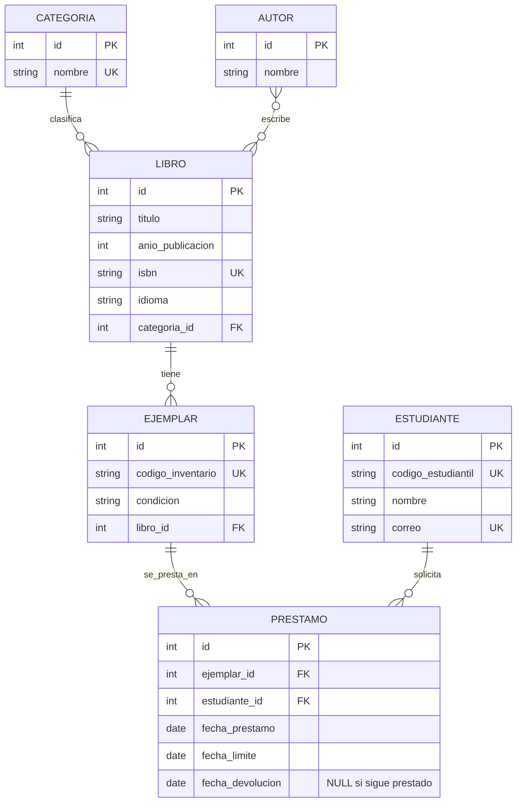

# Biblioteca UFPS — Modelos, Admin y ORM con Django

## 1. Descripción del proyecto

**Biblioteca UFPS** es una aplicación backend desarrollada con Django para gestionar el catálogo bibliográfico y el control de préstamos de una biblioteca universitaria. Está dirigida al personal bibliotecario de la Universidad Francisco de Paula Santander (UFPS) y resuelve el problema de llevar el registro de libros, copias físicas, estudiantes y préstamos en cuadernos, evitando errores como prestar un mismo ejemplar físico a dos estudiantes al mismo tiempo y facilitando búsquedas rápidas de disponibilidad e historial.

---

## 2. Tecnologías

| Tecnología | Versión |
| --- | --- |
| Python | 3.14.4 |
| Django | 6.1.3 |
| Base de datos | SQLite 3 (integrada en Python/Django) |

---

## 3. Instalación y ejecución

Sigue estos pasos desde cero para ejecutar el proyecto localmente:

1. **Clonar el repositorio y entrar a la carpeta del proyecto:**

   ```bash
   git clone <URL_DEL_REPOSITORIO>
   cd <NOMBRE_CARPETA_DEL_REPOSITORIO>
   ```

2. **Crear y activar el entorno virtual:**

   - En **Windows (PowerShell)**:
     ```powershell
     python -m venv .venv
     .venv\Scripts\Activate.ps1
     ```
   - En **Linux / macOS**:
     ```bash
     python3 -m venv .venv
     source .venv/bin/activate
     ```

3. **Instalar las dependencias:**

   ```bash
   pip install -r requirements.txt
   ```

4. **Aplicar las migraciones a la base de datos local (`db.sqlite3`):**

   ```bash
   python manage.py migrate
   ```

5. *(Opcional)* **Cargar datos de prueba iniciales** (4 categorías, 5 autores, 5 libros, 9 ejemplares, 5 estudiantes y 7 préstamos):

   ```bash
   python manage.py cargar_datos
   ```

6. **Crear un superusuario para acceder al panel de administración:**

   ```bash
   python manage.py createsuperuser
   ```

   *(Ingresa un usuario, correo y contraseña propios en la terminal; no se incluyen credenciales reales en el repositorio).*

7. **Arrancar el servidor de desarrollo:**

   ```bash
   python manage.py runserver
   ```

   - Panel de administración: `http://127.0.0.1:8000/admin/`

8. **Ejecutar la suite de pruebas automatizadas:**

   ```bash
   python manage.py test -v 2
   ```

---

## 4. Estructura del proyecto

```text
.
├── biblioteca_ufps/                 # Configuración global del proyecto Django
│   ├── __init__.py
│   ├── asgi.py                      # Punto de entrada ASGI
│   ├── settings.py                  # Configuración (INSTALLED_APPS, BD, idioma es-co, zona horaria)
│   ├── urls.py                      # Rutas principales (incluye /admin/)
│   └── wsgi.py                      # Punto de entrada WSGI
├── biblioteca/                      # Aplicación principal del dominio de biblioteca
│   ├── migrations/                  # Historial de migraciones de la base de datos
│   │   ├── 0001_initial.py          # Creación de los 6 modelos, tabla intermedia M2M y constraint único
│   │   └── 0002_libro_idioma.py     # Evolución del esquema: agrega el campo `idioma` a `Libro`
│   ├── management/
│   │   └── commands/
│   │       └── cargar_datos.py      # Comando personalizado para poblar datos de prueba reproducibles
│   ├── admin.py                     # Personalización completa del panel de administración
│   ├── apps.py                      # Configuración y nombre legible de la app en el admin
│   ├── models.py                    # Definición de los 6 modelos, relaciones y reglas de negocio
│   └── tests.py                     # Pruebas automatizadas de modelos, reglas, admin y optimización ORM
├── manage.py                        # Utilidad CLI de Django (migrate, runserver, shell, test, etc.)
├── requirements.txt                 # Dependencias exactas generadas con pip freeze
├── .gitignore                       # Exclusiones de Git (.venv, __pycache__, db.sqlite3, etc.)
└── README.md                        # Documentación completa del proyecto
```

---

## 5. Modelo de datos

### Diagrama entidad-relación (Mermaid)



### Descripción de las relaciones

- **Categoría — Libro (`1:N`)**: una categoría puede agrupar cero o muchos libros, y cada libro pertenece exactamente a una categoría (`on_delete=models.PROTECT`).
- **Autor — Libro (`N:M`)**: un autor puede haber escrito cero o muchos libros, y un libro puede tener varios autores; Django genera automáticamente la tabla intermedia `biblioteca_libro_autores`.
- **Libro — Ejemplar (`1:N`)**: un libro abstracto (identificado por su ISBN) puede tener cero o muchos ejemplares físicos en estantería, y cada ejemplar corresponde exactamente a un libro (`on_delete=models.PROTECT`). Separarlos evita duplicar título, ISBN, año y autores cuando la biblioteca posee varias copias del mismo título.
- **Ejemplar — Préstamo (`1:N`)**: un ejemplar físico puede aparecer en cero o muchos préstamos a lo largo del tiempo (historial), y cada préstamo involucra exactamente una copia física (`on_delete=models.PROTECT`).
- **Estudiante — Préstamo (`1:N`)**: un estudiante puede realizar cero o muchos préstamos, y cada préstamo pertenece exactamente a un estudiante (`on_delete=models.PROTECT` para impedir borrar estudiantes que tengan historial de préstamos).

### Decisiones de diseño y migraciones

- **Fecha real de devolución (`fecha_devolucion`)**: vive en `Prestamo` con `null=True, blank=True`. Mientras el ejemplar sigue prestado, su valor es `None` (`NULL` en SQL), lo que permite distinguir de forma inequívoca los préstamos activos de los devueltos.
- **Regla de negocio — Una copia no puede estar prestada a dos personas al mismo tiempo**:
  - **Camino elegido**: **restricción en la base de datos (`Meta.constraints`)** usando un `UniqueConstraint` condicional:
    ```python
    models.UniqueConstraint(
        fields=["ejemplar"],
        condition=Q(fecha_devolucion__isnull=True),
        name="unico_prestamo_activo_por_ejemplar",
        violation_error_message=(
            "Este ejemplar ya tiene un préstamo activo y no puede "
            "prestarse nuevamente hasta ser devuelto."
        ),
    )
    ```
  - **Justificación**: a diferencia de `clean()`, que solo se ejecuta en formularios y en el admin (pudiendo saltarse desde el shell con `.save()` o `.create()`), un `UniqueConstraint` parcial genera un índice único directamente en la base de datos (`CREATE UNIQUE INDEX "unico_prestamo_activo_por_ejemplar" ON "biblioteca_prestamo" ("ejemplar_id") WHERE "fecha_devolucion" IS NULL;`). Esto garantiza la integridad sin importar desde dónde se escriban los datos, y además Django valida automáticamente `Meta.constraints` al ejecutar `full_clean()` en el admin, mostrando un mensaje claro al usuario en lugar de un error sin controlar. Una vez que el préstamo anterior registra su `fecha_devolucion`, la condición `IS NULL` deja de aplicarse y el mismo ejemplar puede prestarse nuevamente conservando todo su historial.
  - **Verificación**: probada tanto a nivel de base de datos (`IntegrityError` al crear dos préstamos activos con `.create()`) como a nivel de validación de modelo (`ValidationError` en `full_clean()`) en `biblioteca/tests.py`.
- **Migraciones (`sqlmigrate` y evolución del esquema)**:
  - `0001_initial.py` crea las 6 tablas (`biblioteca_categoria`, `biblioteca_autor`, `biblioteca_libro`, `biblioteca_ejemplar`, `biblioteca_estudiante`, `biblioteca_prestamo`), la tabla intermedia `biblioteca_libro_autores` y el índice único parcial `unico_prestamo_activo_por_ejemplar`.
  - `0002_libro_idioma.py` corresponde al ejercicio corto de evolución del esquema: agrega el campo `idioma` (`default="Español"`) al modelo `Libro`. Si se añade un campo obligatorio (`null=False`) sin valor por defecto sobre una tabla con datos existentes, Django detiene `makemigrations` y pregunta si se desea proporcionar un valor por defecto único para las filas existentes o salir para definir `default=` en el modelo.

---

## 6. Panel de administración

El panel de administración (`/admin/`) fue personalizado en `biblioteca/admin.py` pensando en el flujo diario de una bibliotecaria sin conocimientos técnicos:

| Personalización | Dónde se aplicó | Necesidad de la bibliotecaria que resuelve |
| --- | --- | --- |
| `__str__` legible en todos los modelos | Todos los modelos (`models.py`) | En `Ejemplar`, muestra `LIB-001 — Cien años de soledad (Usado)` en vez de `Ejemplar object (1)`, evitando confusiones entre copias de distintos libros al registrar un préstamo. |
| `search_fields` por código estudiantil, nombre y correo | `EstudianteAdmin` y `PrestamoAdmin` | Permite buscar rápidamente a un estudiante por su código UFPS (`1152001`) o por su nombre sin recorrer listas largas. |
| `autocomplete_fields = ("estudiante", "ejemplar")` | `PrestamoAdmin` (y `"libro"` en `EjemplarAdmin`) | Reemplaza desplegables extensos por buscadores en vivo para elegir sin error el estudiante y la copia física exacta al crear un préstamo. |
| `EstadoPrestamoFilter` + columna booleana `esta_devuelto` | `PrestamoAdmin` | Muestra de un vistazo con un ícono verde/rojo qué préstamos siguen sin devolverse y permite filtrar por **Activos (sin devolver)**, **Devueltos** o **Vencidos**. |
| `readonly_fields = ("fecha_prestamo",)` | `PrestamoAdmin` | Muestra la fecha de salida asignada automáticamente (`auto_now_add=True`) e impide que se altere por accidente. |
| `EjemplarInline` (`TabularInline`) | `LibroAdmin` | Permite registrar y editar varias copias físicas directamente dentro de la ficha del libro sin cambiar de pantalla. |
| `list_display`, `search_fields`, `list_filter` | `LibroAdmin`, `EjemplarAdmin`, `EstudianteAdmin`, `PrestamoAdmin` (y básicos en `CategoriaAdmin` y `AutorAdmin`) | Facilita filtrar libros por categoría/idioma/año, ver qué ejemplares están disponibles y filtrar estudiantes con préstamos activos (`TienePrestamoActivoFilter`). |
| `filter_horizontal = ("autores",)` | `LibroAdmin` | Hace intuitivo asignar múltiples autores a un libro sin tener que mantener presionada la tecla Ctrl. |
| Acción `marcar_como_devueltos` | `PrestamoAdmin` | Permite seleccionar varios préstamos activos en la lista y marcarlos como devueltos con la fecha de hoy en un solo clic. |

---

## 7. Consultas del ORM (Los 10 retos)

Todas las consultas se ejecutaron en `python manage.py shell` sobre el conjunto base cargado con `python manage.py cargar_datos` (4 categorías, 5 autores, 5 libros, 9 ejemplares, 5 estudiantes y 7 préstamos: 3 devueltos y 4 activos).

### Reto 1: Crear un autor, un libro de ese autor y dos copias físicas

```python
# Predicción: se creará la autora Isabel Allende, su novela "La casa de los espíritus"
# asociada a la categoría Novela y dos ejemplares (LIB-010 nuevo y LIB-011 usado).
autor_nuevo = Autor.objects.create(nombre="Isabel Allende")
cat_novela = Categoria.objects.get(nombre="Novela")
libro_nuevo = Libro.objects.create(
    titulo="La casa de los espíritus",
    anio_publicacion=1982,
    isbn="978-0525433477",
    idioma="Español",
    categoria=cat_novela,
)
libro_nuevo.autores.add(autor_nuevo)
ej1 = Ejemplar.objects.create(
    libro=libro_nuevo,
    codigo_inventario="LIB-010",
    condicion=Ejemplar.Condicion.NUEVO,
)
ej2 = Ejemplar.objects.create(
    libro=libro_nuevo,
    codigo_inventario="LIB-011",
    condicion=Ejemplar.Condicion.USADO,
)
```

- **Resultado obtenido**:
  - Autor: `Isabel Allende`
  - Libro: `La casa de los espíritus (1982)`
  - Ejemplares: `['LIB-010 — La casa de los espíritus (Nuevo)', 'LIB-011 — La casa de los espíritus (Usado)']`
  - Coincidió con la predicción.

### Reto 2: Obtener todos los libros de un autor buscando por su nombre

```python
# Predicción: debe devolver los 2 libros de Gabriel García Márquez:
# "Cien años de soledad" y "El amor en los tiempos del cólera".
Libro.objects.filter(autores__nombre__icontains="García Márquez")
```

- **Resultado obtenido**:
  `['Cien años de soledad (1967)', 'El amor en los tiempos del cólera (1985)']`
- Coincidió exactamente con la predicción.

### Reto 3: Obtener libros cuyo título contiene cierta palabra (sin importar mayúsculas)

```python
# Predicción: buscando "de", deberían salir los 4 títulos en español que llevan la palabra "de"
# ("Cien años de soledad", "El amor en los tiempos del cólera", "La casa de los espíritus" y "Sapiens: De animales a dioses").
Libro.objects.filter(titulo__icontains="de")
```

- **Resultado obtenido**:
  `['Cien años de soledad (1967)', 'Clean Code (2008)', 'El amor en los tiempos del cólera (1985)', 'La casa de los espíritus (1982)', 'Sapiens: De animales a dioses (2011)']`
- **Aprendizaje**: la predicción no coincidió al 100 % porque `icontains` busca subcadenas (`LIKE '%de%'`), no palabras completas, por lo que también coincidió con `"Clean Code"` (en `"Co**de**"`).

### Reto 4: Obtener las copias físicas disponibles (sin ningún préstamo activo)

```python
# Predicción inicial: con 11 ejemplares totales (9 iniciales + 2 del Reto 1) y 4 préstamos activos
# (LIB-001, LIB-004, LIB-007, LIB-008), deben quedar 7 ejemplares disponibles.

# Intento inicial (trampa común del ORM):
# Ejemplar.objects.exclude(prestamos__fecha_devolucion__isnull=True)
# ¡Solo devolvió ['LIB-005 — Clean Code (Usado)']! Porque el LEFT OUTER JOIN deja
# fecha_devolucion como NULL en los ejemplares que nunca se han prestado, excluyéndolos también.

# Consulta corregida:
Ejemplar.objects.exclude(
    pk__in=Prestamo.objects.filter(fecha_devolucion__isnull=True).values("ejemplar_id")
)
```

- **Resultado obtenido**:
  `['LIB-002 — Cien años de soledad (Nuevo)', 'LIB-003 — El amor en los tiempos del cólera (Usado)', 'LIB-005 — Clean Code (Usado)', 'LIB-006 — Clean Code (Dañado)', 'LIB-009 — Sapiens: De animales a dioses (Usado)', 'LIB-010 — La casa de los espíritus (Nuevo)', 'LIB-011 — La casa de los espíritus (Usado)']`
- **Aprendizaje**: descubrimos que `exclude(prestamos__fecha_devolucion__isnull=True)` falla para ejemplares sin historial de préstamos debido al `LEFT OUTER JOIN` en SQL. Filtrando por subconsulta (`pk__in`) se obtienen exactamente las 7 copias disponibles.

### Reto 5: Estudiantes con al menos un préstamo activo, sin repetir

```python
# Predicción: deben salir 3 estudiantes únicos (Laura Martínez tiene 2 activos,
# Carlos Ramírez 1 y Andrés López 1). Sofía Gómez (solo devuelto) y Valentina Torres (sin préstamos) no deben aparecer.
Estudiante.objects.filter(
    prestamos__isnull=False,
    prestamos__fecha_devolucion__isnull=True,
).distinct()
```

- **Resultado obtenido**:
  `['1152004 — Andrés López', '1152002 — Carlos Ramírez', '1152001 — Laura Martínez']`
- **Aprendizaje**: fue clave incluir `prestamos__isnull=False` junto a `prestamos__fecha_devolucion__isnull=True` para evitar que un `LEFT OUTER JOIN` incluyera a `Valentina Torres`, y `.distinct()` evitó que `Laura Martínez` saliera repetida por tener 2 préstamos activos.

### Reto 6: Calcular cuántos préstamos ha hecho cada estudiante (contando los devueltos)

```python
# Predicción: Laura 3, Carlos 2, Andrés 1, Sofía 1 y Valentina 0.
from django.db.models import Count

list(
    Estudiante.objects.annotate(total_prestamos=Count("prestamos"))
    .order_by("-total_prestamos", "nombre")
    .values_list("nombre", "total_prestamos")
)
```

- **Resultado obtenido**:
  `[('Laura Martínez', 3), ('Carlos Ramírez', 2), ('Andrés López', 1), ('Sofía Gómez', 1), ('Valentina Torres', 0)]`
- Coincidió exactamente con la predicción.

### Reto 7: Encontrar el libro más prestado de la biblioteca

```python
# Predicción: "Clean Code" debe quedar primero con 3 préstamos (2 devueltos y 1 activo).
from django.db.models import Count

Libro.objects.annotate(
    total_prestamos=Count("ejemplares__prestamos")
).order_by("-total_prestamos").first()
```

- **Resultado obtenido**:
  `Clean Code -> total_prestamos: 3`
- Coincidió exactamente con la predicción.

### Reto 8: Obtener los estudiantes que nunca han pedido un préstamo

```python
# Predicción: debe devolver únicamente a Valentina Torres (código 1152005).
Estudiante.objects.filter(prestamos__isnull=True)
```

- **Resultado obtenido**:
  `['1152005 — Valentina Torres']`
- Coincidió exactamente con la predicción.

### Reto 9: Marcar un préstamo como devuelto con la fecha de hoy y comprobarlo

```python
# Predicción: al asignar timezone.localdate() y guardar, al consultar de nuevo por pk
# el campo fecha_devolucion debe persistir con la fecha actual y esta_activo pasar a False.
from django.utils import timezone

prestamo_activo = Prestamo.objects.filter(fecha_devolucion__isnull=True).order_by("id").first()
prestamo_activo.fecha_devolucion = timezone.localdate()
prestamo_activo.save()

prestamo_verificado = Prestamo.objects.get(pk=prestamo_activo.pk)
```

- **Resultado obtenido**:
  `LIB-004 -> Andrés López [Devuelto (2026-11-22)] | fecha_devolucion: 2026-11-22`
- Coincidió con la predicción y el cambio quedó guardado en SQLite.

### Reto 10: Borrar un autor y observar qué pasa con sus libros

```python
# Predicción: como la relación Libro-Autor es ManyToManyField, borrar el autor solo debe
# eliminar el registro en biblioteca_autor y su vínculo en la tabla intermedia biblioteca_libro_autores,
# dejando el libro "La casa de los espíritus" intacto (ahora con 0 autores).
autor_borrar = Autor.objects.get(nombre="Isabel Allende")
borrado_info = autor_borrar.delete()
libro_tras_borrar = Libro.objects.get(isbn="978-0525433477")
```

- **Resultado obtenido**:
  - Retorno de `.delete()`: `(2, {'biblioteca.Libro_autores': 1, 'biblioteca.Autor': 1})`
  - Libro tras borrar autor: `La casa de los espíritus (1982)` sigue existiendo; `libro_tras_borrar.autores.all()` devuelve `[]`.
- **Explicación**: un `ManyToManyField` no recibe `on_delete` en el campo del modelo; Django crea una tabla intermedia (`biblioteca_libro_autores`) cuyas dos claves foráneas apuntan con `CASCADE` a `Libro` y `Autor`. Por eso, al eliminar un `Autor`, SQL borra únicamente las filas de enlace en la tabla intermedia y el propio registro de `Autor`, sin eliminar ningún `Libro` del catálogo.

---

## 8. Optimización (Problema N+1)

Mediciones realizadas con `CaptureQueriesContext(connection)` sobre el conjunto de prueba inicial (**7 préstamos** y **5 libros**):

### Caso 1: Listar préstamos con nombre del estudiante y título del libro (`select_related`)

- **Predicción antes de medir**: 1 consulta inicial para traer los 7 préstamos + 3 consultas adicionales por cada préstamo (`estudiante`, `ejemplar` y `ejemplar.libro`) = $1 + 7 \times 3 = 22$ consultas.
- **Código antes (N+1)**:
  ```python
  for p in Prestamo.objects.all():
      print(p.estudiante.nombre, p.ejemplar.libro.titulo)
  ```
- **Código después (optimizado)**:
  ```python
  for p in Prestamo.objects.select_related("estudiante", "ejemplar__libro"):
      print(p.estudiante.nombre, p.ejemplar.libro.titulo)
  ```

### Caso 2: Listar cada libro con todos sus autores (`prefetch_related`)

- **Predicción antes de medir**: 1 consulta para traer los 5 libros + 1 consulta por cada libro para traer sus autores = $1 + 5 = 6$ consultas.
- **Código antes (N+1)**:
  ```python
  for libro in Libro.objects.all():
      print(libro.titulo, [a.nombre for a in libro.autores.all()])
  ```
- **Código después (optimizado)**:
  ```python
  for libro in Libro.objects.prefetch_related("autores"):
      print(libro.titulo, [a.nombre for a in libro.autores.all()])
  ```

### Tabla comparativa de resultados

| Consulta | Consultas antes | Consultas después | Herramienta aplicada |
| --- | :---: | :---: | --- |
| Préstamos con `estudiante.nombre` y `ejemplar.libro.titulo` (7 préstamos) | **22** | **1** | `select_related("estudiante", "ejemplar__libro")` |
| Libros con lista de `autores` (5 libros) | **6** | **2** | `prefetch_related("autores")` |

### ¿Por qué `select_related` no sirve para los libros y sus autores?

`select_related` funciona generando un `SQL JOIN` en una única consulta y está diseñado exclusivamente para relaciones de un solo valor (`ForeignKey` y `OneToOneField`). En una relación `ManyToManyField` (un libro puede tener muchos autores), un `JOIN` multiplicaría las filas del libro por cada autor asociado (y si se combinan varias relaciones hacia muchos, provocaría un producto cartesiano con duplicación masiva de datos). Por eso Django prohíbe usar `select_related` en `ManyToManyField` (lanza `FieldError`) y ofrece `prefetch_related`, que realiza una segunda consulta independiente con `WHERE libro_id IN (...)` y enlaza los objetos en memoria en Python.

---

## 9. Uso de inteligencia artificial

- **Agente utilizado**: Antigravity (asistente de IA de desarrollo).
- **Qué se le pidió**:
  1. Revisar el enunciado de la actividad y estructurar el proyecto Django, los 6 modelos, la restricción de unicidad condicional y el comando `cargar_datos` con datos de prueba consistentes.
  2. Generar el diagrama Mermaid de tipo `erDiagram` a partir de `biblioteca/models.py` con entidades, campos principales y cardinalidades.
  3. Ejecutar y verificar las 10 consultas del ORM, las mediciones N+1 y la suite de pruebas automatizadas.
- **Qué se revisó y corrigió**:
  1. **Consultas con `fecha_devolucion__isnull=True` en relaciones inversas**: al probar el Reto 4 y el filtro `TienePrestamoActivoFilter` en `biblioteca/admin.py`, detectamos que `exclude(prestamos__fecha_devolucion__isnull=True)` y `filter(prestamos__fecha_devolucion__isnull=True)` producían resultados incorrectos por culpa del `LEFT OUTER JOIN` en SQL (incluían estudiantes sin préstamos y excluían copias nunca prestadas). Se corrigió tanto en `biblioteca/admin.py` como en las consultas de los Retos 4 y 5 usando subconsultas (`pk__in`) y `prestamos__isnull=False`, y se agregó una prueba unitaria específica en `biblioteca/tests.py`.
  2. **Revisión del diagrama Mermaid**: se contrastó campo por campo contra `biblioteca/models.py` para confirmar que no existieran campos inventados, que las 4 relaciones `ForeignKey` tuvieran el lado `"uno"` (`||`) en la entidad destino y `"cero o muchos"` (`o{`) en la entidad hija, que `AUTOR }o--o{ LIBRO` quedara como muchos a muchos y que el campo opcional `fecha_devolucion` indicara explícitamente que admite `NULL`.

---

## 10. Equipo y reflexión

### Integrantes del grupo

NICOLAS OSWALDO FLOREZ DUARTE - 1152474

### Preguntas de reflexión

1. **¿Qué parte de su diseño cambió después de escribir las primeras consultas, y por qué?**
   Al escribir las consultas de los Retos 4 y 5 y probar los filtros del panel de administración, notamos lo sutil que es consultar el estado activo de un préstamo a través de un campo nullable (`fecha_devolucion__isnull=True`) desde el lado inverso (`Ejemplar` o `Estudiante`): un `LEFT OUTER JOIN` hace que los registros sin ningún préstamo también cumplan `fecha_devolucion IS NULL`. Esto nos llevó a corregir el filtro personalizado `TienePrestamoActivoFilter` en `admin.py` para usar subconsultas sobre `Prestamo`, y además confirmamos lo útil que fue definir `related_name` explícitos (`libros`, `ejemplares`, `prestamos`) en todas las relaciones para que las consultas encadenadas como `Count("ejemplares__prestamos")` fueran legibles y directas.

2. **¿En qué se equivocó el agente con el diagrama y cómo lo notaron?**
   Al contrastar la primera propuesta del diagrama y los filtros contra `models.py`, verificamos dos puntos críticos: primero, asegurarnos de que la relación `AUTOR`—`LIBRO` usara `}o--o{` (muchos a muchos) en lugar de una relación uno a muchos o de inventar una tabla intermedia que no está declarada como modelo explícito en `models.py`; y segundo, verificar que cada `ForeignKey` (`categoria`, `libro`, `ejemplar`, `estudiante`) tuviera el extremo `||` en el modelo padre porque todos son obligatorios (`null=False`), mientras que `fecha_devolucion` quedara documentado como nullable. Lo notamos comparando cada atributo y `on_delete` de `models.py` contra el SQL real emitido por `python manage.py sqlmigrate biblioteca 0001`.

3. **¿Qué decisión de su modelo defenderían ante otro grupo y cuál cambiarían si empezaran de nuevo?**
   - **Lo que defenderíamos**: implementar la regla de la copia prestada mediante `UniqueConstraint(fields=["ejemplar"], condition=Q(fecha_devolucion__isnull=True))` en `Meta.constraints` junto con `on_delete=models.PROTECT` en las claves foráneas críticas. La restricción parcial en base de datos es imposible de burlar desde el shell o scripts masivos, y `PROTECT` protege el historial de préstamos frente a borrados accidentales.
   - **Lo que cambiaríamos si empezáramos de nuevo**: agregaríamos una restricción adicional `CheckConstraint` en `Prestamo` para garantizar a nivel de base de datos que `fecha_limite >= fecha_prestamo` y `fecha_devolucion >= fecha_prestamo` (cuando no sea `NULL`), y consideraríamos permitir `null=True` o un campo opcional `observaciones` en `Ejemplar` para que la bibliotecaria pueda anotar detalles específicos de daño (por ejemplo, "páginas 12-15 subrayadas") más allá de la etiqueta `Nuevo / Usado / Dañado`.
